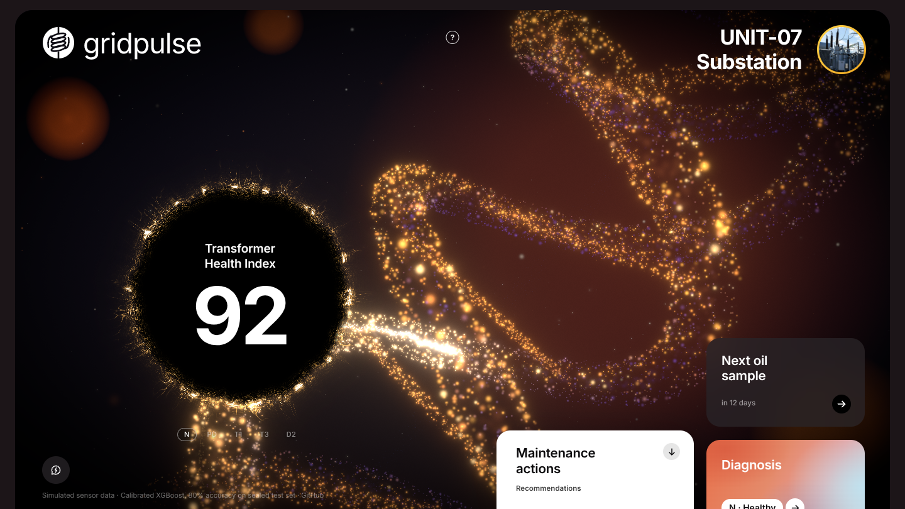
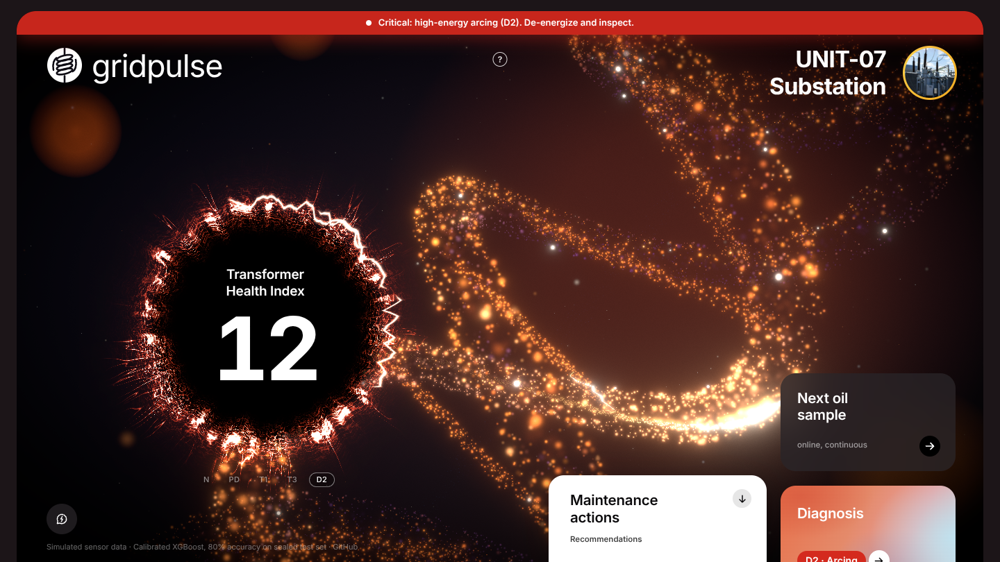

# GridPulse: transformer health dashboard

A cinematic, real-time health dashboard for a power transformer, built as the portfolio front end
for my final-year electrical engineering + ML project,
**[Intelligent Transformer Health Monitoring using Dissolved Gas Analysis (DGA) and ML](https://github.com/AR0714/transformer-health-dga)**.

A copper transformer winding made of glowing particles carries a current pulse, while a Health Index
orb burns with a flame edge that changes with the fault the model detects. Click the orb for the
dissolved-gas breakdown, the model's reasoning (SHAP) and how it compares with the Duval triangle,
or ask the built-in diagnostic assistant about the unit.



<details>
<summary>High-energy arcing (D2) state</summary>



</details>

> **Honest note:** the sensor data is simulated. The model metrics (80.0% accuracy, Duval 57.1%,
> SHAP drivers, calibration) come from the
> [transformer-health-dga](https://github.com/AR0714/transformer-health-dga) project.

## What it shows

| | |
|---|---|
| **Health Index orb** | 0–100 score that ticks one integer at a time as the live gases drift. Its flame edge reflects the fault: calm amber (N), blue-white corona sparks (PD), orange tendrils (T1), white-hot rim (T3), red lightning arcs (D2). |
| **Particle winding coil** | ~25k-particle HV/LV double winding with a jagged current pulse; it speeds up, brightens and stutters as the fault gets worse. |
| **Live DGA feed** | Seven gases (H₂, CH₄, C₂H₆, C₂H₄, C₂H₂, CO, CO₂) re-read every 3 s with ±4% jitter, checked against IEC 60599 typical limits. |
| **Dissolved gases modal** | TDCG, each gas's share, the key gas for the fault, an interpretation, the top SHAP drivers, and XGBoost vs the Duval triangle. |
| **Maintenance actions** | Three IEC 60599 / IEEE C57.104-based actions for the current fault. |
| **Diagnostic assistant** | Answers questions about the unit with Llama 3.3 70B on Groq, through a Netlify Function; falls back to rule-based answers when no key is set. |

Five scenarios: **N** normal · **PD** partial discharge · **T1** thermal < 300 °C · **T3** thermal > 700 °C · **D2** high-energy arcing.
Switch with the pills under the orb or keys **1–5**.

### Model results (from the ML project)

- Calibrated XGBoost: **80.0%** accuracy on a sealed 70-sample test set, vs **57.1%** for the classical Duval triangle (+23 points).
- SHAP confirms the model relies on acetylene (C₂H₂) to detect arcing (SHAP +0.74).
- Calibration cut the expected calibration error from 0.15 to 0.10.

## Tech stack

- Vite + React 19 + TypeScript, Tailwind CSS v4, Inter via `@fontsource`
- three.js with `@react-three/fiber`, `@react-three/drei` and `@react-three/postprocessing` (Bloom, Vignette, Noise)
- Custom GLSL: particle winding (per-particle lighting and depth of field), current pulse and sparks, and a WebGL2 flame-ring shader for the orb
- `framer-motion` for cards, modal and the ticking number; Zustand for scenario and live gas state
- Netlify Functions (`netlify/functions/chat.ts`) calling Groq `llama-3.3-70b-versatile`

## Run it locally

Requires Node 18+.

```bash
npm install
npm run dev          # http://localhost:5173
```

`npm run dev` also serves `/api/chat` with the real Netlify Function, so the assistant works locally.
Without a key it answers from its offline rules.

Other scripts:

```bash
npm run build        # type-check + production build into dist/
npm run preview      # serve the production build
npx netlify dev      # full Netlify emulation (site + functions) on http://localhost:8888
```

### Groq API key (optional)

1. Create a free key at <https://console.groq.com/keys>.
2. Copy `.env.example` to `.env` and fill it in:
   ```
   GROQ_API_KEY=gsk_...
   ```
3. Restart `npm run dev`.

The key is only read on the server (the Netlify Function, or the dev server's function middleware).
It is never bundled into the browser code, and `.env` is git-ignored.

## Deploy on Netlify

`netlify.toml` already sets the build command (`npm run build`), the publish directory (`dist`) and
the functions directory (`netlify/functions`). Import the GitHub repo in Netlify and add
`GROQ_API_KEY` under **Site configuration → Environment variables**.

## Project structure

```
src/
  App.tsx, main.tsx, index.css
  data/scenarios.ts        five fault scenarios, IEC limits, SHAP drivers, actions
  store/useMonitor.ts      Zustand store: scenario + live gas feed
  lib/dga.ts               TDCG, ratios, limit checks, jitter, Health Index
  lib/looks.ts             per-fault visual looks, blended over ~1 s
  lib/assistantContext.ts  system prompt, live context, request validation
  lib/fallback.ts          rule-based assistant answers
  scene/                   Canvas + post-processing, winding coil + pulse, core, dust
  ui/                      top bar, orb + flame ring, cards, modal, assistant, alert strip
netlify/functions/chat.ts  POST /api/chat → Groq
docs/                      screenshots (docs/progress holds the build-phase comparisons)
```

## Accessibility and performance

- Real buttons with visible focus rings; the modal traps focus, and Esc closes it.
- `prefers-reduced-motion` freezes the coil, pulse, flicker and card animations.
- Responsive: on phones (≤ 768 px) the orb moves to the top, the coil sits behind it, and the cards stack below.
- The 3D scene is lazy-loaded after the UI paints. Pixel ratio is capped at 1.75 and drops to 1 when frames suffer; rendering pauses when the tab is hidden.

Handy URL parameters: `?scenario=D2` opens straight into a fault; `?freeze=1.2` pins the animation clock (used for screenshots).

## Credits

Visual design adapted from the "artery" health-app concept on Dribbble, reworked for a power transformer.
